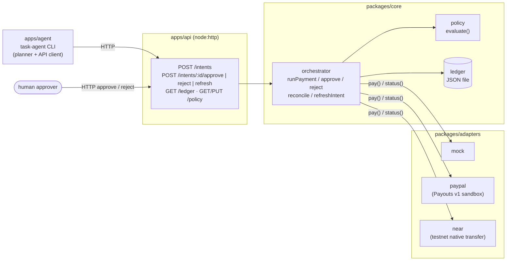

# agent-pay

Policy-guarded payments for AI agents: an agent asks to pay, a policy engine decides, a ledger records every
step, and a payment rail adapter moves the money only when the decision allows it.

## Problem

An AI agent that can spend money needs more than an API key for a payment provider. Without guard rails it can:

- spend more than intended, in one payment or over a day,
- pay someone it should not pay,
- pay twice when a request is retried,
- make large payments that no human has looked at,
- report a payment as done while the rail has not actually settled it.

## Solution

agent-pay puts a small, auditable layer between the agent and the payment rail:

- **Payment intents.** The agent never calls the rail directly. It submits an intent (`agentId`, `payee`,
  `amount`, `currency`, `purpose`) to the API.
- **Policy engine.** Each intent is checked against the agent's policy: per-transaction max, daily max,
  payee allowlist, currency, and an approval threshold. The result is `approved`, `rejected` or `needs_approval`.
- **Ledger.** Intents, decisions, payments and receipts are written to a JSON ledger file, in a fixed order.
  Replaying the same intent returns the stored result instead of paying again.
- **Human approval.** Intents above the threshold wait until a person approves or rejects them over HTTP.
  Hard limits are checked again at approval time.
- **Adapters.** Only approved intents reach a rail adapter: `mock` (default), `paypal` (PayPal Payouts v1
  sandbox) or `near` (NEAR testnet native transfer).
- **Reconciliation.** Receipts the rail reports as `pending` can be refreshed later. A receipt that turns out
  `failed` is marked failed and no longer counts toward the daily total.

## Architecture



| Package | What it does | Docs |
|---|---|---|
| `packages/core` | Types, policy engine, ledger, orchestrator, reconciliation. No runtime deps. | [packages/core/README.md](packages/core/README.md) |
| `packages/adapters` | `mock`, PayPal Payouts v1 (`paypal`), PayPal Orders v2 (`paypal-orders`) and NEAR (`near`) rail adapters. | [packages/adapters/README.md](packages/adapters/README.md) |
| `apps/api` | HTTP API over core. Env vars, endpoints, status codes. | [apps/api/README.md](apps/api/README.md) |
| `apps/agent` | Demo task-agent CLI: task → quote → intent → approval wait → receipt wait. | [apps/agent/README.md](apps/agent/README.md) |

The API serves three rails, chosen with `RAIL`. `paypal` sends a Payouts v1 sandbox payout to an email payee;
`near` signs one native NEAR transfer on testnet. Neither supports refunds. The Orders v2 adapter (`paypal-orders`)
lives in `packages/adapters` only; it is not a server rail, so `RAIL=paypal-orders` exits 1 with `unknown_rail`.
`GET /rail` reports the rail, currency and logical payee → address map; the agent planner stays rail-agnostic and
uses it to map its quotes (details in [apps/api/README.md](apps/api/README.md#per-rail-demo-seed)).

Project description and demo video script: [docs/submission/](docs/submission/).
Moving from mock to PayPal sandbox and NEAR testnet: [docs/live-readiness.md](docs/live-readiness.md).

## Quick start

Requires **Node 24** (TypeScript runs directly through Node's type stripping; no build step).

```sh
npm install
npm test             # node --test in every workspace
npm run typecheck    # tsc in every workspace
```

Start the API (terminal 1). It listens on `http://127.0.0.1:8787` with the `mock` rail. By default the ledger is
`apps/api/.data/ledger.json` (gitignored); set `LEDGER_PATH` to start from an empty ledger:

```sh
LEDGER_PATH=/tmp/agent-pay-demo/ledger.json npm run api
# agent-pay api listening on http://127.0.0.1:8787 (rail=mock, ledger=/tmp/agent-pay-demo/ledger.json)
```

To keep settings in a file instead, `cp .env.example .env` (gitignored; key names only, empty = default) and fill
it in. `npm run api` loads the root `.env` when it exists; without one, Node prints `.env not found. Continuing
without it.` and the defaults apply.

`npm run demo` starts the API and the web UI together on a fresh ledger (ports `DEMO_API_PORT`, default 8787, and
`DEMO_WEB_PORT`, default 5173). Its rail comes from the shell, default `mock` (`RAIL=near npm run demo`); a root
`.env` is passed to the API when present. If the API cannot start (for example missing credentials), the demo
prints the API's names-only message, stops what it started, and exits 1.

Run the three scenarios (terminal 2):

```sh
npm run agent -- --scenario small
npm run agent -- --scenario over-limit
npm run agent -- --scenario needs-approval --auto-approve-as alice
```

The agent first calls `GET /health` (if the API is not reachable it exits 1 immediately), then reads the rail
once from `GET /rail` and prints `server: http://127.0.0.1:8787 rail=mock`. `--rail <name>` makes it exit 1 when
the server runs a different rail.
Add `--json` for NDJSON output (`npm run agent -- --scenario small --json`). npm prints its `> agent` banner on
stdout first, so when piping NDJSON use `npm run -s agent -- ...`, which also hides npm's error footer on a
non-zero exit.

## Reproduce from a fresh clone

Requirements: Node 24 (`node --version` ≥ 24), npm, and Corepack for the web UI's pinned pnpm
(`corepack enable`, or set `COREPACK_HOME` to a writable directory). The repository is private, so cloning needs
access to it.

```sh
git clone https://github.com/tmdry4530/agent-pay.git
cd agent-pay
npm install            # core, adapters, api, agent (no third-party runtime deps)
npm run web:install    # apps/web via pnpm (needed by the root test/typecheck scripts and npm run demo)
npm run typecheck
npm test               # mocks only: no network, no credentials. The live integration tests skip themselves.
```

All three rails use the same commands; only `RAIL` and the rail's env vars change. Keep values in a root `.env`
(`cp .env.example .env`; `.env` is gitignored). The placeholders below are **not** real values: never commit a
filled-in `.env`, and never paste a key into an issue or chat.

### Mock rail (default, no credentials)

```sh
LEDGER_PATH=/tmp/agent-pay-mock/ledger.json npm run api                # terminal 1
npm run agent -- --scenario small                                       # terminal 2, exit 0
npm run agent -- --scenario over-limit                                  # exit 2
npm run agent -- --scenario needs-approval --auto-approve-as alice      # exit 0
```

Or `npm run demo` for the API plus the web UI on a fresh temp ledger. The expected output is in
[Scenarios](#scenarios).

### PayPal Payouts sandbox (`RAIL=paypal`)

You need a PayPal developer **sandbox** REST app (client id and secret) and a sandbox **personal** account to
receive payouts. Step by step: [docs/live-readiness.md §1](docs/live-readiness.md#1-paypal-sandbox-railpaypal).

```sh
# .env (placeholders)
RAIL=paypal
PAYPAL_CLIENT_ID=<sandbox-app-client-id>
PAYPAL_CLIENT_SECRET=<sandbox-app-client-secret>
# PAYPAL_BASE_URL empty = https://api-m.sandbox.paypal.com; do not point it at the live API
DEMO_PAYEES=openai-api=<sandbox-personal-email>
# optional: make the 10 USD small scenario stop for approval on stage
# DEMO_APPROVAL_ABOVE=5
```

```sh
LEDGER_PATH=/tmp/agent-pay-paypal/ledger.json npm run api   # terminal 1: "... (rail=paypal, ...)"
npm run agent -- --rail paypal --scenario small             # terminal 2
```

A payout batch can stay `PENDING`/`PROCESSING` for a while after the item succeeds. The receipt stays `pending`
until the batch is final. The API's background poller (`RECEIPT_POLL_MS`, default 5 s, for up to
`RECEIPT_POLL_TIMEOUT_MS`, default 10 min) and `POST /intents/:id/refresh` settle it. If the agent's receipt wait
ends first, it exits 3 (`receipt_pending`); `GET /ledger` shows the final state later. When PayPal returns an
error, the receipt's `meta` records `errorStatus`, `errorName`, `errorMessage`, `errorDebugId` and `errorDetails`.
Token-like strings are redacted, and request headers are never recorded.

Live integration test (one 0.01 USD sandbox payout): set `PAYPAL_CLIENT_ID`, `PAYPAL_CLIENT_SECRET` and
`PAYPAL_PAYOUT_RECEIVER=<sandbox-personal-email>`, then `npm test -w @agent-pay/adapters`.

### NEAR testnet (`RAIL=near`)

You need a funded sender `.testnet` account with its private key, plus a receiver account. near-cli-rs 0.30
commands: [docs/live-readiness.md §2](docs/live-readiness.md#2-near-testnet-railnear).

```sh
# .env (placeholders)
RAIL=near
NEAR_ACCOUNT_ID=<sender>.testnet
NEAR_PRIVATE_KEY=<ed25519:... private key of the sender>
# NEAR_NETWORK empty = testnet; NEAR_RPC_URL empty = https://test.rpc.fastnear.com
DEMO_PAYEES=openai-api=<receiver>.testnet
```

```sh
LEDGER_PATH=/tmp/agent-pay-near/ledger.json npm run api   # terminal 1: "... (rail=near, ...)"
npm run agent -- --rail near --scenario small             # terminal 2: sends 0.1 NEAR
```

Set `DEMO_PAYEES`: the default NEAR payee `demo-merchant.testnet` may not exist on testnet, and a transfer to a
missing account fails. Live integration test (one 0.001 NEAR transfer): set `NEAR_ACCOUNT_ID`,
`NEAR_PRIVATE_KEY` and `NEAR_RECEIVER_ID=<receiver>.testnet`, then `npm test -w @agent-pay/adapters`.

### Demo payee map (`DEMO_PAYEES`)

The agent's planner only knows logical payee names: `openai-api`, `anthropic-api`, `vercel` and `near-compute`.
The API maps them to rail addresses and serves the map on `GET /rail`. `DEMO_PAYEES` is a comma-separated list
of `name=address` pairs. When set, it **replaces** the whole default map, and the policy allowlist becomes those
addresses. The built-in scenarios pay `openai-api`.

```sh
DEMO_PAYEES=openai-api=<receiver>.testnet,anthropic-api=<receiver>.testnet,vercel=<receiver>.testnet,near-compute=<receiver>.testnet
```

`apps/api/src/main.ts` passes the environment to `railSeed()` in
[`apps/api/src/seed.ts`](apps/api/src/seed.ts), which parses the value with `parseDemoPayees()`. The API exits 1
at startup with a `demo_payees:` error in any of these cases:

- an item is not `name=address`;
- a name is repeated;
- on `RAIL=paypal`, an address is not an email;
- on `RAIL=near`, an address fails `isAcceptedPayee()` for `NEAR_NETWORK`. On testnet that means it is not
  `*.testnet` or a 64-char hex implicit account.

The NEAR check is format-only; it does not ask the network whether the account exists. `RAIL=mock` ignores
`DEMO_PAYEES`. More detail: [docs/live-readiness.md](docs/live-readiness.md#demo-payee-map-demo_payees).

### Demo approval threshold (`DEMO_APPROVAL_ABOVE`)

The seed policies require human approval above 50 USD (`mock`, `paypal`) or 0.5 NEAR (`near`). Those defaults
stay unchanged unless you set `DEMO_APPROVAL_ABOVE=<number>` in the rail's currency. It must be ≥ 0 and below
the rail's per-transaction max (100 USD / 1 NEAR). Otherwise the API exits 1 with
`invalid_demo_approval_above`. For example, `DEMO_APPROVAL_ABOVE=5` makes the 10 USD `small` scenario return
`needs_approval`, so a live demo can show human approval while spending very little. `npm run demo` passes it
through from the shell (`DEMO_APPROVAL_ABOVE=5 npm run demo`).

## Scenarios

On the `mock` rail the API starts with this policy for `demo-agent`: per-transaction max 100 USD, daily max 200 USD, approval
required above 50 USD, payees `openai-api`, `anthropic-api`, `vercel`, `near-compute`. The agent's rule-based
planner quotes 10 USD per 1M GPT tokens. Intent ids and receipt ids below are random per run.

### 1. `small`: paid within policy (exit 0)

```text
[task] scenario "small": buy 1M tokens of GPT inference
[quote] rule-based quoted 10 USD to openai-api (buy 1M tokens of GPT inference (1 x 1M tokens @ 10 USD))
[submit_intent] POST http://127.0.0.1:8787/intents as demo-agent
[intent_result] paid: within_policy: amount 10 USD to "openai-api" is within policy
Done: paid (exit 0)
Reason: within_policy: amount 10 USD to "openai-api" is within policy
Receipt: mock mock_… (succeeded)
```

### 2. `over-limit`: rejected by policy (exit 2)

```text
[task] scenario "over-limit": buy 15M tokens of GPT inference
[quote] rule-based quoted 150 USD to openai-api (buy 15M tokens of GPT inference (15 x 1M tokens @ 10 USD))
[submit_intent] POST http://127.0.0.1:8787/intents as demo-agent
[intent_result] rejected: per_tx_limit_exceeded: amount 150 exceeds per-transaction max 100
Done: rejected (exit 2)
Reason: per_tx_limit_exceeded: amount 150 exceeds per-transaction max 100
```

No payment is attempted. (`npm run` then prints its own `Lifecycle script ... failed` footer because the exit
code is non-zero; `npm run -s` hides it.)

### 3. `needs-approval`: human approves, then paid (exit 0)

```text
[task] scenario "needs-approval": buy 7.5M tokens of GPT inference
[quote] rule-based quoted 75 USD to openai-api (buy 7.5M tokens of GPT inference (7.5 x 1M tokens @ 10 USD))
[submit_intent] POST http://127.0.0.1:8787/intents as demo-agent
[intent_result] needs_approval: approval_required: amount 75 is above approval threshold 50
[await_approval] waiting for human approval (simulated by --auto-approve-as "alice")
[auto_approve] simulated human "alice" calls POST /intents/pi_…/approve
[approve_result] paid: approved_by_human: approved by "alice"; 75 USD to "openai-api" is within hard limits
Done: paid (exit 0)
Reason: approved_by_human: approved by "alice"; 75 USD to "openai-api" is within hard limits
Receipt: mock mock_… (succeeded)
```

`--auto-approve-as` is a demo shortcut: the CLI itself plays the human. To approve as a real person, run the
scenario without it and approve the printed intent id from another terminal:

```sh
npm run agent -- --scenario needs-approval
curl -X POST localhost:8787/intents/<intent id>/approve -H 'content-type: application/json' -d '{"approver":"alice"}'
```

The agent polls `GET /ledger`, sees `paid`, and exits 0. (`POST /intents/<id>/reject` makes it exit 2.)

Paid amounts count toward the 200 USD daily max, so on one ledger a later run of the same UTC day can be rejected
with `daily_limit_exceeded`. Use a fresh `LEDGER_PATH` to reset.

### Exit codes

| Code | Status | Meaning |
|---|---|---|
| 0 | `paid` | Payment went through (receipt `succeeded`) |
| 2 | `rejected` | Rejected by policy or by a human |
| 3 | `approval_timeout` / `receipt_pending` | No human decision within `--timeout-ms`, or the receipt was still `pending` after the receipt wait |
| 1 | `failed` / `error` | The rail declined the payment, or the agent could not finish (bad arguments, API down, HTTP error) |

## Safety

- **Spending limits.** Every intent is checked against `perTxMax` and `dailyMax` (per agent, per UTC day of
  `intent.createdAt`) in the policy's single `currency`. Approved amounts are reserved toward the daily total as
  soon as they are approved; failed payments are not counted.
- **Payee allowlist.** Payees outside `allowedPayees` are rejected with `payee_not_allowed` before any rail call.
- **Idempotency and duplicate prevention.** Re-sending an intent with the same `id` and `createdAt` returns the
  stored result (`replayed: true`, HTTP 200) and never pays twice; the same `id` with different fields is
  `409 intent_conflict`. The ledger enforces order (intent → decision → payment → receipt), allows one payment
  per intent, serializes writes within the process, and writes atomically (temp file + rename). Use one API
  process per ledger file.
- **Human approval.** Intents above `requireApprovalAbove` are stored as `needs_approval` and are paid only after
  `POST /intents/:id/approve`. Limits and the allowlist are re-checked at approval time, and a second
  approve/reject of the same intent gets `409`.
- **Reconciliation.** A `pending` receipt is not treated as final. `POST /intents/:id/refresh` (and core
  `reconcile` for a whole rail) asks the adapter for the current status, validates the answer, and settles the
  ledger only when the status changed: `failed` marks the payment failed and frees its amount from the daily
  total. Running it again writes nothing. The agent polls refresh after a paid result with a pending receipt.
  Details: [apps/api/README.md](apps/api/README.md), [packages/core/README.md](packages/core/README.md).
- **No secrets in the repo.** The default `mock` rail needs no credentials, and the agent makes no LLM or other
  paid API calls. PayPal and NEAR credentials are read only from your shell environment.
- **Environment variables** (API; full table in [apps/api/README.md](apps/api/README.md)):

  | Var | Default | |
  |---|---|---|
  | `PORT` | `8787` | `0` picks a random port |
  | `HOST` | `127.0.0.1` | Bind address (local only by default) |
  | `LEDGER_PATH` | `apps/api/.data/ledger.json` | Ledger file; one writer process per file |
  | `RAIL` | `mock` | `mock`, `paypal` (Payouts v1 sandbox) or `near` (NEAR testnet native transfer) |
  | `PAYPAL_CLIENT_ID`, `PAYPAL_CLIENT_SECRET`, `PAYPAL_BASE_URL` | | Only for `RAIL=paypal` (sandbox) |
  | `NEAR_ACCOUNT_ID`, `NEAR_PRIVATE_KEY`, `NEAR_NETWORK`, `NEAR_RPC_URL` | | Only for `RAIL=near` (`NEAR_NETWORK` defaults to `testnet`, `NEAR_RPC_URL` to `https://test.rpc.fastnear.com`) |
  | `DEMO_PAYEES` | | Optional for `paypal` / `near`: `name=address,...` replaces the default payee map ([details](#demo-payee-map-demo_payees)) |
  | `DEMO_APPROVAL_ABOVE` | | Optional: lowers the approval threshold for a live demo ([details](#demo-approval-threshold-demo_approval_above)) |
  | `RECEIPT_POLL_MS`, `RECEIPT_POLL_TIMEOUT_MS` | `5000`, `600000` | Background refresh of `pending` receipts after a paid result; `RECEIPT_POLL_MS=0` turns it off |

  All names are in [.env.example](.env.example). With `RAIL=paypal` or `RAIL=near` and a required var unset, the API exits 1 and
  lists the missing names (never values), e.g.
  `missing required env vars for RAIL=paypal: PAYPAL_CLIENT_ID, PAYPAL_CLIENT_SECRET`.

  The API answers CORS only for `localhost` / `127.0.0.1` origins. The policy is kept in memory and resets to the
  seed policy when the API restarts (`PUT /policy` changes it until then).

## NEAR's role in agent-pay

NEAR is one of the two real payment rails, next to PayPal. agent-pay is a rail-agnostic control layer: the agent,
the policy engine and the ledger don't change when the money moves on NEAR instead of PayPal. On `RAIL=near`:

- **Seed policy in NEAR.** The policy currency is `NEAR`: per-transaction max 1, daily max 2, approval above
  0.5. `GET /rail` publishes `amountScale` 0.01, so the planner's 10 USD quote becomes a 0.1 NEAR intent.
- **Payee allowlist of NEAR account ids.** Logical payees map to `.testnet` accounts (or implicit accounts) through
  `DEMO_PAYEES`. The adapter refuses a payee that is not valid for the configured network.
- **Native transfer, signed locally.** [`packages/adapters/src/near.ts`](packages/adapters/src/near.ts) builds
  one native NEAR `Transfer`, signs it with the sender's ed25519 key, and submits it with `send_tx`
  (`wait_until: FINAL`). It uses a zero-dependency JSON-RPC client
  ([`near-rpc.ts`](packages/adapters/src/near-rpc.ts)) against the FASTNEAR public testnet RPC by default.
- **Only final transactions settle.** A receipt becomes `succeeded` or `failed` only when the RPC reports
  `final_execution_status: FINAL`. Any other outcome stays `pending`, and the API's refresh calls `tx` to check
  again. If the outcome is unknown (for example, no transaction hash), the receipt is held `pending` with
  `needsManualResolve`. The amount stays reserved against the daily limit until an operator resolves it. NEAR
  transfers are final, so there is no refund path.

Scope: testnet only. Mainnet code paths exist but have not been run; see
[docs/live-readiness.md](docs/live-readiness.md) for the risks.

## Hackathon submissions (disclosure)

This project is submitted to **two** hackathons: the **PayPal AI Hackathon** and the **NEAR HACKATHON**. It is the
same codebase in both: the PayPal Payouts sandbox rail and the NEAR testnet rail sit side by side behind one
policy engine and ledger, and this README describes both. Submission text and the demo video
script: [docs/submission/](docs/submission/).

## Changes since 2026-10-01

A summary of `git log --since=2026-10-01` (about 200 commits, built 2026-10-28 to 2026-10-30, plus this
branch on 2026-11-01):

- **Core** (`packages/core`):
  - policy engine, JSON ledger and payment orchestrator;
  - decision history with actors on each ledger entry;
  - reconciliation and refresh of pending receipts;
  - operator manual resolve (`resolvedBy` required).
  - A hardening pass (F1–F16):
    - atomic evaluate-and-record, so concurrent intents can't exceed the daily max;
    - ledger validation on read, fsync and a cross-process lock file;
    - per-currency daily totals in integer minor units, on the server clock;
    - a `submitting` status before the rail call, with default timeouts around rail calls;
    - unknown outcomes held `pending` with `needsManualResolve`.
- **Adapters** (`packages/adapters`):
  - `mock`;
  - PayPal Payouts v1 sandbox (`paypal`);
  - PayPal Orders v2 (`paypal-orders`, adapter-side only);
  - a NEAR testnet native-transfer adapter with a zero-dependency RPC client and FINAL-only settlement;
  - error fixtures taken from the PayPal and NEAR docs.
- **API** (`apps/api`):
  - `node:http` routes for intents, approve/reject/refresh/resolve, ledger, policy, `/rail` and `/health`;
  - per-rail seeds and `DEMO_PAYEES`;
  - startup errors that list missing env names only;
  - hardening: the CSRF origin guard (`403 forbidden_origin`), `Idempotency-Key`, a PayPal timeout, the
    `{error, message}` contract, `415`, and `409` race codes.
- **Agent CLI** (`apps/agent`):
  - a rule-based planner and three scenarios;
  - approval and receipt polling;
  - `--json` NDJSON output and exit codes.
- **Web** (`apps/web`):
  - a Vite + React demo wired to the real API (or an in-memory core);
  - decision history, Refresh and Resolve flows, `409` and stuck-submitting banners;
  - a redesign and an accessibility pass.
- **Demo and docs**:
  - `npm run demo`, Playwright recordings and a 170 s submission video with voiceover;
  - the live-readiness checklist, the submission description and per-package READMEs.
- **This branch** (2026-11-01):
  - MIT license;
  - a PayPal receipt now stays `pending` until the payout batch is final, and the API polls pending receipts;
  - PayPal failure details (status, name, message, debug_id, details) are recorded in the receipt, redacted;
  - `DEMO_APPROVAL_ABOVE`;
  - NEAR CLI commands in near-cli-rs 0.30 syntax;
  - `DEMO_PAYEES` docs;
  - the sandbox/testnet E2E status in the submission description.

## License

[MIT](LICENSE) © 2026 tmdry4530
