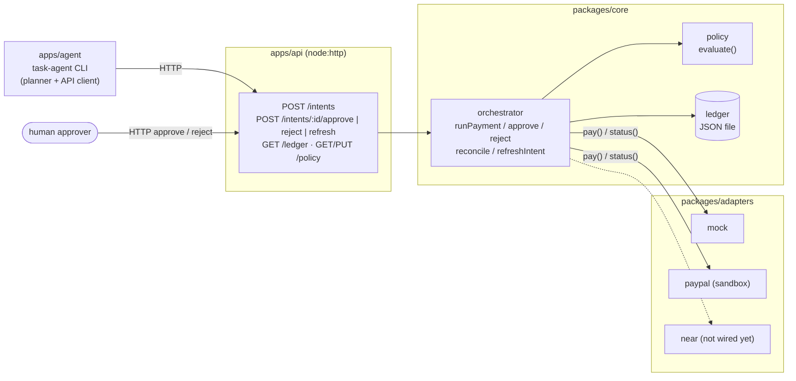

# agent-pay

Policy-guarded payments for AI agents: an agent asks to pay, a policy engine decides, a ledger records every
step, and a payment rail adapter moves the money only when the decision allows it.

## Problem

An AI agent that can spend money needs more than an API key for a payment provider. Without guard rails it can:

- spend more than intended, in one payment or over a day,
- pay someone it should not pay,
- pay twice when a request is retried,
- make large payments that no human has looked at,
- report a payment as done while the rail has not actually settled it.

## Solution

agent-pay puts a small, auditable layer between the agent and the payment rail:

- **Payment intents.** The agent never calls the rail directly. It submits an intent (`agentId`, `payee`,
  `amount`, `currency`, `purpose`) to the API.
- **Policy engine.** Each intent is checked against the agent's policy: per-transaction max, daily max,
  payee allowlist, currency, and an approval threshold. The result is `approved`, `rejected` or `needs_approval`.
- **Ledger.** Intents, decisions, payments and receipts are written to a JSON ledger file, in a fixed order.
  Replaying the same intent returns the stored result instead of paying again.
- **Human approval.** Intents above the threshold wait until a person approves or rejects them over HTTP.
  Hard limits are checked again at approval time.
- **Adapters.** Only approved intents reach a rail adapter (`mock` or PayPal sandbox).
- **Reconciliation.** Receipts the rail reports as `pending` can be refreshed later. A receipt that turns out
  `failed` is marked failed and no longer counts toward the daily total.

## Architecture



| Package | What it does | Docs |
|---|---|---|
| `packages/core` | Types, policy engine, ledger, orchestrator, reconciliation. No runtime deps. | [packages/core/README.md](packages/core/README.md) |
| `packages/adapters` | `mock` and PayPal sandbox (Orders v2) rail adapters. | [packages/adapters/README.md](packages/adapters/README.md) |
| `apps/api` | HTTP API over core. Env vars, endpoints, status codes. | [apps/api/README.md](apps/api/README.md) |
| `apps/agent` | Demo task-agent CLI: task → quote → intent → approval wait → receipt wait. | [apps/agent/README.md](apps/agent/README.md) |

The `near` rail slot exists in the API's adapter registry but has no adapter yet: `RAIL=near` exits at startup
with `adapter_not_wired`.

## Quick start

Requires **Node 24** (TypeScript runs directly through Node's type stripping; no build step).

```sh
npm install
npm test             # node --test in every workspace
npm run typecheck    # tsc in every workspace
```

Start the API (terminal 1). It listens on `http://127.0.0.1:8787` with the `mock` rail. By default the ledger is
`apps/api/.data/ledger.json` (gitignored); set `LEDGER_PATH` to start from an empty ledger:

```sh
LEDGER_PATH=/tmp/agent-pay-demo/ledger.json npm start -w @agent-pay/api
# agent-pay api listening on http://127.0.0.1:8787 (rail=mock, ledger=/tmp/agent-pay-demo/ledger.json)
```

Run the three scenarios (terminal 2):

```sh
npm run agent -w @agent-pay/agent -- --scenario small
npm run agent -w @agent-pay/agent -- --scenario over-limit
npm run agent -w @agent-pay/agent -- --scenario needs-approval --auto-approve-as alice
```

Add `--json` for NDJSON output, or use `npm run -s agent ...` to hide npm's banner and its error footer on a
non-zero exit.

## Scenarios

The API starts with this policy for `demo-agent`: per-transaction max 100 USD, daily max 200 USD, approval
required above 50 USD, payees `openai-api`, `anthropic-api`, `vercel`, `near-compute`. The agent's rule-based
planner quotes 10 USD per 1M GPT tokens. Intent ids and receipt ids below are random per run.

### 1. `small`: paid within policy (exit 0)

```text
[task] scenario "small": buy 1M tokens of GPT inference
[quote] rule-based quoted 10 USD to openai-api (buy 1M tokens of GPT inference (1 x 1M tokens @ 10 USD))
[submit_intent] POST http://127.0.0.1:8787/intents as demo-agent
[intent_result] paid: within_policy: amount 10 USD to "openai-api" is within policy
Done: paid (exit 0)
Reason: within_policy: amount 10 USD to "openai-api" is within policy
Receipt: mock mock_… (succeeded)
```

### 2. `over-limit`: rejected by policy (exit 2)

```text
[task] scenario "over-limit": buy 15M tokens of GPT inference
[quote] rule-based quoted 150 USD to openai-api (buy 15M tokens of GPT inference (15 x 1M tokens @ 10 USD))
[submit_intent] POST http://127.0.0.1:8787/intents as demo-agent
[intent_result] rejected: per_tx_limit_exceeded: amount 150 exceeds per-transaction max 100
Done: rejected (exit 2)
Reason: per_tx_limit_exceeded: amount 150 exceeds per-transaction max 100
```

No payment is attempted. (`npm run` then prints its own `Lifecycle script ... failed` footer because the exit
code is non-zero; `npm run -s` hides it.)

### 3. `needs-approval`: human approves, then paid (exit 0)

```text
[task] scenario "needs-approval": buy 7.5M tokens of GPT inference
[quote] rule-based quoted 75 USD to openai-api (buy 7.5M tokens of GPT inference (7.5 x 1M tokens @ 10 USD))
[submit_intent] POST http://127.0.0.1:8787/intents as demo-agent
[intent_result] needs_approval: approval_required: amount 75 is above approval threshold 50
[await_approval] waiting for human approval (simulated by --auto-approve-as "alice")
[auto_approve] simulated human "alice" calls POST /intents/pi_…/approve
[approve_result] paid: approved_by_human: approved by "alice"; 75 USD to "openai-api" is within hard limits
Done: paid (exit 0)
Reason: approved_by_human: approved by "alice"; 75 USD to "openai-api" is within hard limits
Receipt: mock mock_… (succeeded)
```

`--auto-approve-as` is a demo shortcut: the CLI itself plays the human. To approve as a real person, run the
scenario without it and approve the printed intent id from another terminal:

```sh
npm run agent -w @agent-pay/agent -- --scenario needs-approval
curl -X POST localhost:8787/intents/<intent id>/approve -H 'content-type: application/json' -d '{"approver":"alice"}'
```

The agent polls `GET /ledger`, sees `paid`, and exits 0. (`POST /intents/<id>/reject` makes it exit 2.)

Paid amounts count toward the 200 USD daily max, so on one ledger a later run of the same UTC day can be rejected
with `daily_limit_exceeded`. Use a fresh `LEDGER_PATH` to reset.

### Exit codes

| Code | Status | Meaning |
|---|---|---|
| 0 | `paid` | Payment went through (receipt `succeeded`) |
| 2 | `rejected` | Rejected by policy or by a human |
| 3 | `approval_timeout` / `receipt_pending` | No human decision within `--timeout-ms`, or the receipt was still `pending` after the receipt wait |
| 1 | `failed` / `error` | The rail declined the payment, or the agent could not finish (bad arguments, API down, HTTP error) |

## Safety

- **Spending limits.** Every intent is checked against `perTxMax` and `dailyMax` (per agent, per UTC day of
  `intent.createdAt`) in the policy's single `currency`. Approved amounts are reserved toward the daily total as
  soon as they are approved; failed payments are not counted.
- **Payee allowlist.** Payees outside `allowedPayees` are rejected with `payee_not_allowed` before any rail call.
- **Idempotency and duplicate prevention.** Re-sending an intent with the same `id` and `createdAt` returns the
  stored result (`replayed: true`, HTTP 200) and never pays twice; the same `id` with different fields is
  `409 intent_conflict`. The ledger enforces order (intent → decision → payment → receipt), allows one payment
  per intent, serializes writes within the process, and writes atomically (temp file + rename). Use one API
  process per ledger file.
- **Human approval.** Intents above `requireApprovalAbove` are stored as `needs_approval` and are paid only after
  `POST /intents/:id/approve`. Limits and the allowlist are re-checked at approval time, and a second
  approve/reject of the same intent gets `409`.
- **Reconciliation.** A `pending` receipt is not treated as final. `POST /intents/:id/refresh` (and core
  `reconcile` for a whole rail) asks the adapter for the current status, validates the answer, and settles the
  ledger only when the status changed: `failed` marks the payment failed and frees its amount from the daily
  total. Running it again writes nothing. The agent polls refresh after a paid result with a pending receipt.
  Details: [apps/api/README.md](apps/api/README.md), [packages/core/README.md](packages/core/README.md).
- **No secrets in the repo.** The default `mock` rail needs no credentials, and the agent makes no LLM or other
  paid API calls. PayPal sandbox credentials are read only from your shell environment.
- **Environment variables** (API; full table in [apps/api/README.md](apps/api/README.md)):

  | Var | Default | |
  |---|---|---|
  | `PORT` | `8787` | `0` picks a random port |
  | `HOST` | `127.0.0.1` | Bind address (local only by default) |
  | `LEDGER_PATH` | `apps/api/.data/ledger.json` | Ledger file; one writer process per file |
  | `RAIL` | `mock` | `mock` or `paypal` (`near` is not wired yet) |
  | `PAYPAL_CLIENT_ID`, `PAYPAL_CLIENT_SECRET`, `PAYPAL_BASE_URL` | | Only for `RAIL=paypal` (sandbox) |

  The API answers CORS only for `localhost` / `127.0.0.1` origins. The policy is kept in memory and resets to the
  seed policy when the API restarts (`PUT /policy` changes it until then).
